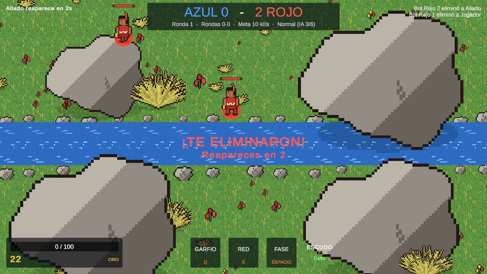

# Arena del Garfio

Videojuego de habilidad, estrategia y **memoria** en **pixel art**, hecho en **Unity 6 (6000.5.4f1)** y basado en una historia real del Perú: la **guerra civil inca (1529-1532)** entre los ejércitos de **Huáscar (Cusco)** y **Atahualpa (Quito)**. Dos bandos separados por un río: la única forma de atacar es lanzar el garfio, atrapar al enemigo y arrastrarlo a tu orilla.

> **Versión 3 en desarrollo (reforma).** Ya están hechos el pixel art, la vista 2D y la versión web. Las tareas pendientes del equipo están en **[TAREAS_EQUIPO.md](TAREAS_EQUIPO.md)**.

## Jugar en línea

**https://valentinoch-fel.github.io/ArenaDelGarfio/**: se juega en el navegador, sin descargar nada (computadora con teclado y mouse).

## Descargar y jugar (Mac)

En **[Releases](../../releases/latest)** descarga **ArenaDelGarfio_Instalador_Mac_v3.0.dmg**, ábrelo y arrastra el juego a Aplicaciones.

> La primera vez ábrelo con **clic derecho → Abrir** (la app no está firmada por Apple). Requisitos: macOS 12 o superior.

## Pixel art

Todos los personajes, escenarios y objetos están dibujados en pixel art por el equipo:

- Archivos PNG originales y versiones ampliadas: carpeta [`PixelArt/`](PixelArt/).
- Hoja con todos los dibujos: [`PixelArt/hoja_pixel_art.png`](PixelArt/hoja_pixel_art.png).
- Pantallazos del juego en JPG y PNG: carpeta [`Capturas/`](Capturas/).

Personajes: **guerrero**, **chasqui** y **orejón**, en el bando azul (Cusco) y el rojo (Quito). Escenarios: pradera andina, cañón del Apurímac y puna. Elementos andinos: muros de piedra inca, ichu, queñua, cantuta, cactus San Pedro y chakana.

> El link de juego en línea y los instaladores publicados todavía son de la versión anterior (3D). Se actualizan al publicar la v3 en pixel art (tarea P1 de [TAREAS_EQUIPO.md](TAREAS_EQUIPO.md)).

## Descargar y jugar (Windows)

Ve a **[Releases](../../releases/latest)** y descarga:

- **ArenaDelGarfio_Instalador_v2.1.exe**: instalador (crea accesos directos y desinstalador).
- **ArenaDelGarfio_Portable_v2.1.zip**: sin instalar; descomprime y abre `ArenaDelGarfio.exe`.

> Windows puede mostrar "Windows protegió su PC" porque el instalador no está firmado. Haz clic en **Más información → Ejecutar de todas formas**.

Requisitos: Windows 10/11 de 64 bits.

## La historia

El río Ankari parte en dos el valle de Garfia. En su fondo duerme el **Ancla del Titán**, que da fuerza a quien domine sus aguas. Los clanes **Marea** y **Brasa** pelearon por ella hasta que el río quedó maldito: quien lo cruza a pie no vuelve. Juraron no pisar el agua jamás… pero el pacto no dice nada de *traer* al enemigo. Así nació el garfio. En cada equinoccio, los mejores garfieros luchan de orilla a orilla.

La historia se cuenta en una intro animada al abrir el juego (se salta con un clic).

## Controles

| Jugador 1 | Jugador 2 (modo 2 Jugadores) | Acción |
|---|---|---|
| W A S D | Flechas | Moverse |
| Mouse | Dirección de movimiento | Apuntar |
| Q / clic izquierdo | `.` | Garfio |
| E / clic derecho | `,` | Red (inmoviliza 2.5 s) |
| Espacio | `-` | Fase (invulnerable 1.5 s) |
| F | M | Escudo (refleja el garfio) |
| B | | Tienda |
| Esc | | Pausa |

El jugador 2 también puede usar un mando.

## Características

- **4 modos:** Clásico (tú y un aliado contra 2 bots, mejor de 3 rondas), Supervivencia (oleadas y récord), 2 Jugadores en la misma PC y **Memoria**.
- **Modo Memoria · Runas del Ancla (v3.0):** 6 runas del río se encienden en un orden; memorízalo y engánchalas con el garfio en el mismo orden. Cada nivel suma una runa (como la prueba de bloques de Corsi). 3 vidas, récord y estadísticas de aciertos y precisión. Código en `Assets/_Project/Scripts/MemoryMode.cs`.
- **3 personajes:** Equilibrado, Veloz y Tanque, con distinta vida, velocidad y garfio.
- **3 arenas:** Pradera, Desierto y Nieve (con bloques de hielo que se mueven).
- **Escudo** que devuelve el garfio al que lo lanzó.
- IA con 6 niveles que sube por ronda y cuando vas ganando.
- Tienda con 8 mejoras, runas en el río, rachas y estadísticas al final de la partida.

## Presentación y capturas

La presentación del modo Memoria (PPTX y PDF) y las capturas del juego están en [`Entrega/Memoria`](Entrega/Memoria).

## Abrir el proyecto

Abre esta carpeta con **Unity 6000.5.4f1** desde Unity Hub.

- Compilar para Mac desde la terminal: `Unity -batchmode -quit -projectPath . -buildTarget StandaloneOSX -executeMethod MacBuild.Build` (sale en `Build/Mac`).
- Prueba automática del modo Memoria: abre el juego compilado con `-capturas <carpeta>`; juega solo, guarda capturas y escribe `[AUTOTEST]` en el registro.

## Integrantes

- Joel Ángel Ocaño Ore
- Felipe Valentino Calderón Hurtado
- Javier Josué Gómez
- Paulo Miguel Armijo Rojas

## Créditos

- Modelos y efectos de sonido: [Kenney](https://kenney.nl) (CC0).
- Música: "Thatched Villagers" y "Five Armies" de Kevin MacLeod ([incompetech.com](https://incompetech.com)), licencia [CC BY 4.0](https://creativecommons.org/licenses/by/4.0/).
- Íconos de la intro: [game-icons.net](https://game-icons.net) (CC BY 3.0).
- Motor: Unity 6 con URP, Input System, AI Navigation y TextMeshPro.
- Inspirado en el modo Pudge Wars de Dota (sin recursos de Valve).
